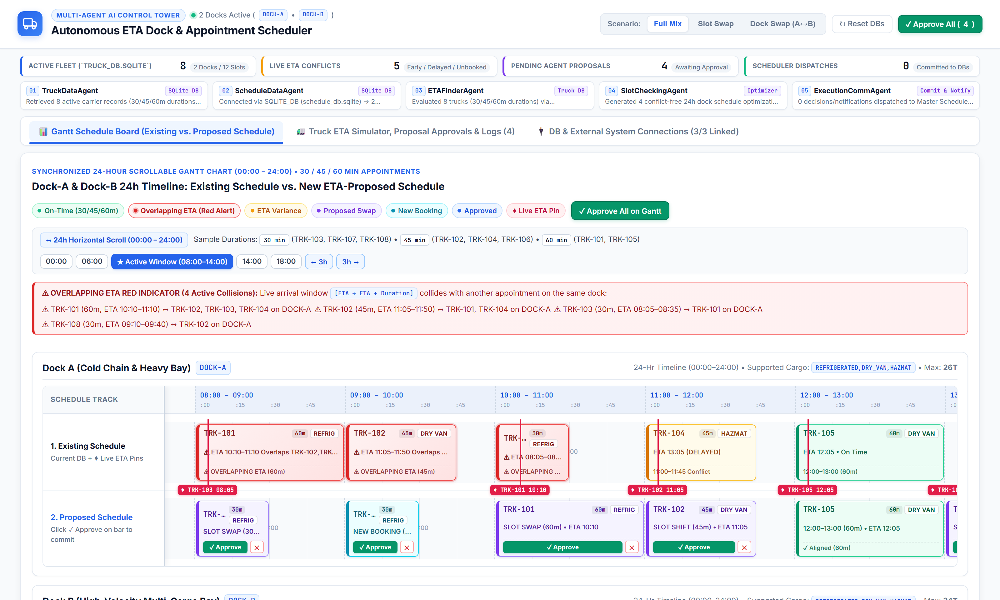
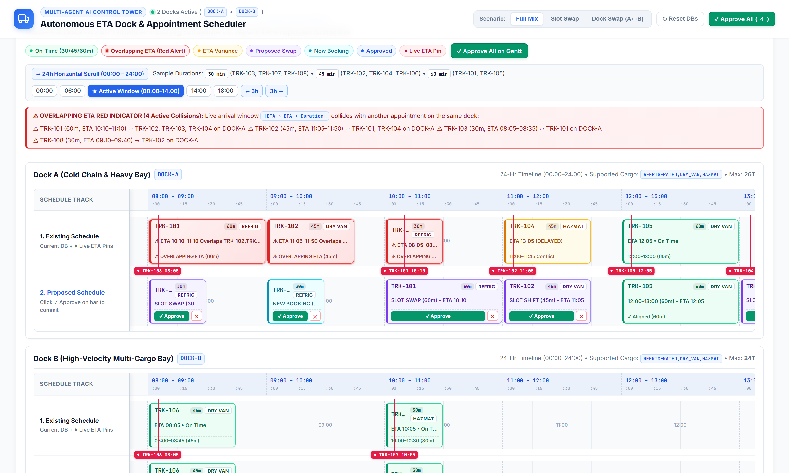
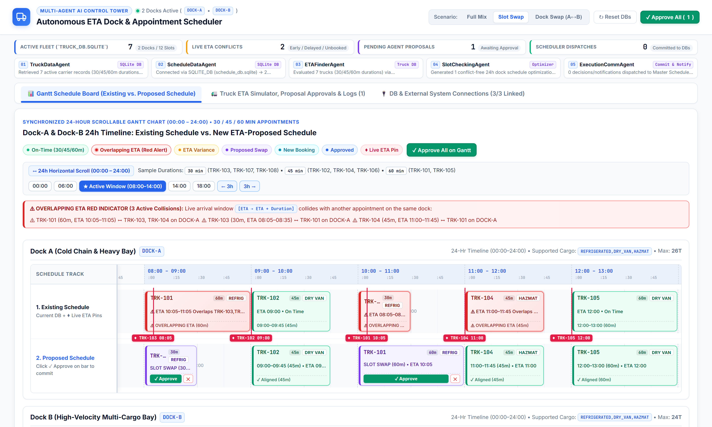
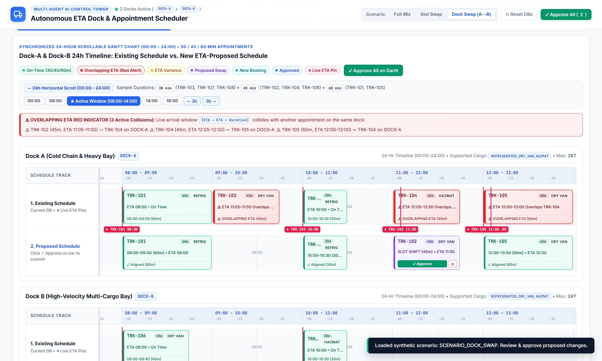
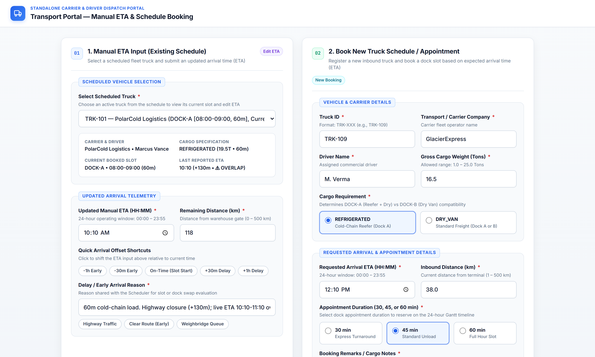

# Autonomous Multi-Agent ETA Dock & Slot Scheduler

An AI Control Tower for real-time warehouse dock & appointment scheduling powered by a **5-Agent Autonomous Pipeline**, **Dual SQLite Databases**, **Pluggable External TMS/WMS/Telematics Connectors**, a **24-Hour Scrollable Gantt Chart** (`30m` / `45m` / `60m` durations with frozen track labels & Overlapping ETA Red Indicator), and a **Standalone Carrier Transport Portal (`/transport`)**.



---

## Key Features

1. **5 Specialized Autonomous Agents (`backend/agents.py`)**
   - **Agent 01 — `TruckDataAgent`**: Connects to `truck_db.sqlite` (or external TMS REST/SQL link) to load inbound fleet manifests, cargo types (`REFRIGERATED`, `DRY_VAN`, `FLATBED`), weights, appointment durations (`30m`, `45m`, `60m`), and live ETAs.
   - **Agent 02 — `ScheduleDataAgent`**: Connects to `schedule_db.sqlite` (or external WMS link) to load dock bay capabilities (`DOCK-A` & `DOCK-B`) and 24-hour slot occupancy (`00:00`–`24:00`).
   - **Agent 03 — `ETAFinderAgent`**: Computes arrival variance ($\Delta = \text{ETA} - \text{ScheduledStart}$) and live arrival windows $[\text{ETA}, \text{ETA} + \text{Duration}]$, flagging **Overlapping ETA Red Indicators** whenever two trucks collide on the same dock.
   - **Agent 04 — `SlotCheckingAgent`**: Multi-constraint optimizer that resolves conflicts using:
     - **Pairwise Slot Swap (`SLOT_SWAP`)**: Swaps an early truck with a delayed truck on the same dock.
     - **Cross-Dock Swap (`DOCK_SWAP`)**: Reallocates a delayed truck from an occupied dock bay to an open, cargo-compatible bay on the alternate dock (`DOCK-A` $\leftrightarrow$ `DOCK-B`).
     - **Slot Time Shift (`SLOT_TIME_SHIFT`)** & **New Appointment Booking (`BOOK_NEW_APPOINTMENT`)**.
   - **Agent 05 — `ExecutionCommAgent`**: Atomically commits approved schedule proposals across both `schedule_db.sqlite` and `truck_db.sqlite` and dispatches notifications to the Master Scheduler and Drivers.

2. **24-Hour Scrollable Gantt Chart with Frozen Left Track Column**
   - Full `00:00`–`24:00` timeline (`5760px` synchronized horizontal scroll) with `:00` / `:15` / `:30` / `:45` sub-hour markers.
   - **Frozen Left Column**: `Schedule Track`, `1. Existing Schedule`, and `2. Proposed Schedule` remain pinned while scrolling horizontally.
   - **Variable Appointment Durations**: Proportional `30m`, `45m`, and `60m` slot bars.
   - **Overlapping ETA Red Indicator**: Visual red collision alert banner + pulsing red bars when live arrival windows overlap on the same dock.

3. **Built-In Live Demo Scenarios**
   - **Full Mix (`SCENARIO_FULL_MULTI_AGENT`)**: Combined Slot Swap, Cross-Dock Swap, Time Shift, and Unbooked Truck scenario.
   - **Slot Swap (`SCENARIO_SLOT_SWAP`)**: Clean pairwise slot swap between `TRK-101` and `TRK-103` on `DOCK-A`.
   - **Dock Swap (`SCENARIO_DOCK_SWAP`)**: Cross-dock reallocation (`DOCK-A` $\rightarrow$ `DOCK-B`) for `TRK-102` and `TRK-104`.

4. **Pluggable External DB & System Connection Hub**
   - Configure, test, bind, and sync external `SQLite`, `REST API`, `PostgreSQL URI`, or `Telematics Webhook` endpoints for Truck DB (`TMS`), Schedule DB (`WMS`), and Live ETA (`Telematics`).

5. **Standalone Carrier & Driver Transport Portal (`/transport`)**
   - Strictly separated from the internal Control Tower UI.
   - **1. Manual ETA Input (Existing Schedule)** & **2. Book New Truck Schedule / Appointment (`30m` / `45m` / `60m`)**.

---

## Screenshots

### 24-Hour Scrollable Gantt Chart & Overlapping ETA Red Indicator


### Scenario 1: Pairwise Slot Swap (`SLOT_SWAP`)


### Scenario 2: Cross-Dock Swap (`DOCK_SWAP`: `DOCK-A` $\leftrightarrow$ `DOCK-B`)


### Standalone Transport Portal (`/transport`)


---

## Project Structure

```text
multi_agent_dock_scheduler/
├── backend/
│   ├── __init__.py
│   ├── agents.py                # 5 Autonomous Agents & MultiAgentOrchestrator
│   ├── connectors.py            # External TMS / WMS / Telematics DB & API connectors
│   └── database.py              # Dual SQLite initialization & synthetic seed data
├── data/
│   ├── truck_db.sqlite          # Fleet & Live ETA database
│   └── schedule_db.sqlite       # Dock slots, schedules & communications database
├── docs/
│   └── screenshots/             # Product screenshots (Slides 01–11)
├── static/
│   ├── index.html               # Main Control Tower UI (/)
│   ├── transport.html           # Standalone Carrier Transport Portal (/transport)
│   ├── styles.css               # UI styling & 24-hr frozen-column Gantt layout
│   ├── app.js                   # Control Tower frontend logic
│   └── transport.js             # Transport Portal frontend logic
├── server.py                    # FastAPI REST API server
├── run.py                       # Application launcher (port 8050)
├── test_multi_agent_system.py   # Automated verification suite
├── generate_ppt_and_screenshots.py # Automated screenshot & 14-slide PPTX generator
├── Autonomous_Multi_Agent_Dock_Scheduler_Presentation.pptx
└── requirements.txt
```

---

## Quick Start

1. **Install dependencies**:
   ```bash
   pip install -r requirements.txt
   ```

2. **Start the server**:
   ```bash
   python run.py
   ```

3. **Open in browser**:
   - **Main Control Tower**: `http://127.0.0.1:8050/`
   - **Standalone Transport Portal**: `http://127.0.0.1:8050/transport`
